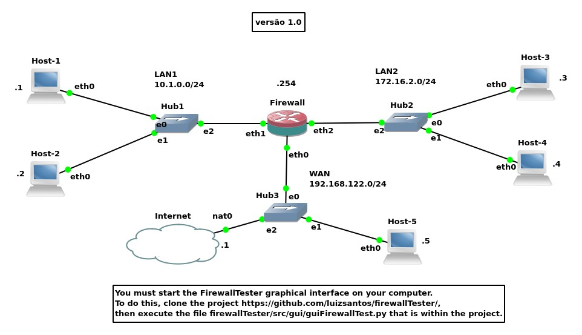

# DMZ + Screened LAN — iptables Firewall

[ [English](#english) | [Português](#português) ]

---

## English

Given the network environment below, the task is to create the firewall rules described.

### Topology

| Network | Address            | Firewall Interface | Hosts                                   |
|---------|--------------------|--------------------|-----------------------------------------|
| LAN1    | `10.1.0.0/24`      | `eth1` (`.254`)    | Host-1 (`.1`), Host-2 (`.2`)            |
| LAN2    | `172.16.2.0/24`    | `eth2` (`.254`)    | Host-3 (`.3`), Host-4 (`.4`)            |
| WAN     | `192.168.122.0/24` | `eth0` (`.254`)    | Host-5 (`.5`), Internet/NAT (`.1`)      |

### 1. Firewall scenario

Configure **Firewall-1** with `iptables` as follows:

1.1. In the `filter` table, the chains must have the following policies:
- `FORWARD` – accept everything;
- `INPUT` and `OUTPUT` – deny everything.

1.2. LAN1 is a *screened* LAN, meaning it can only act as a client, never as a server;

1.3. LAN2 is a DMZ, where:

- 1.3.1. LAN1 hosts can access LAN2 hosts via SSH – every DMZ host runs an SSH server for remote management.
- 1.3.2. Host3 can only be accessed via HTTP and HTTPS, meaning it must act only as an HTTP/HTTPS server. This must also be possible from the Internet/WAN;
- 1.3.3. Host4 can only be accessed via DNS, meaning it must act only as a DNS server and nothing else. This must also be possible from the Internet/WAN;
- 1.3.4. DMZ hosts can only access (as clients) HTTP, HTTPS and DNS on the Internet.

1.4. The firewall must not allow TELNET and SNMP connections between the networks.

1.5. Host1 must be able to access the firewall via TELNET and SSH, but this must be restricted by physical (MAC) address, IP address and network interface.

1.6. The firewall must be able to access, as a client, HTTP/HTTPS and DNS services, only on LAN2 and the Internet.

1.7. LAN1 and LAN2 hosts can ping the firewall, but this must not be possible from the WAN and the Internet.

### 2. Tests

It was highly recommended to implement this scenario using **FirewallTester** (developed specifically for the firewall classes at UTFPR), available at <https://github.com/luizabasseto/firewallTester/>. The tool lets you configure the running services, edit and apply firewall rules and, most importantly, test whether the rules meet the scenario requirements.

2.1. Services running on the scenario hosts:

- Every host on the network must run the following services/ports:
  - FTP (TCP/21)
  - SSH (TCP/22)
  - TELNET (TCP/23)
  - HTTP (TCP/80)
  - TCP/81
  - TCP/8080
  - DNS (UDP/53)
  - SNMP (UDP/161)

- The firewall must run all the host services, **EXCEPT** HTTP, HTTPS and DNS.

2.2. Tests: available at <https://github.com/luizabasseto/firewallTester/>. The activity can be done without the tool, but it makes things much easier.

### 3. Solution

[`solution/firewall.sh`](solution/firewall.sh)

---

## Português

Dado o ambiente de rede foi solicitado para criar as regras de firewall descrito.

### Topologia

| Rede | Endereço          | Interface do Firewall | Hosts                                   |
|------|-------------------|-----------------------|-----------------------------------------|
| LAN1 | `10.1.0.0/24`     | `eth1` (`.254`)       | Host-1 (`.1`), Host-2 (`.2`)            |
| LAN2 | `172.16.2.0/24`   | `eth2` (`.254`)       | Host-3 (`.3`), Host-4 (`.4`)            |
| WAN  | `192.168.122.0/24`| `eth0` (`.254`)       | Host-5 (`.5`), Internet/NAT (`.1`)      |

### 1. Cenário de firewall

Configure o **Firewall-1** via `iptables` da seguinte forma:

1.1. Na tabela `filter`, as situações devem estar com as seguintes políticas:
- `FORWARD` – aceitar tudo;
- `INPUT` e `OUTPUT` – negar tudo.

1.2. A LAN1 é uma LAN *screened*, ou seja, ela só pode ser cliente e não servidor;

1.3. A LAN2 é uma DMZ, sendo que:

- 1.3.1. Os hosts da LAN1 podem acessar os hosts da LAN2 via SSH – há servidores SSH em cada host da DMZ para gerenciamento remoto.
- 1.3.2. O Host3 só pode ser acessado via HTTP e HTTPS, ou seja, ele só deve ser um servidor HTTP/HTTPS. Isso também deve ser possível a partir da Internet/WAN;
- 1.3.3. O Host4 só pode ser acessado via DNS, ou seja, ele só pode ser servidor DNS e nada mais. Isso também deve ser possível a partir da Internet/WAN;
- 1.3.4. Os hosts da DMZ podem acessar (ser clientes) apenas HTTP, HTTPS e DNS da Internet.

1.4. O firewall não deve permitir conexões via TELNET e SNMP entre as redes.

1.5. O Host1 deve acessar o firewall via TELNET e SSH, mas isso deve ser controlado via endereço físico, IP e interface de rede.

1.6. O Firewall deve acessar como cliente os serviços de HTTP/HTTPS e DNS, apenas na LAN2 e Internet.

1.7. Os hosts da LAN1 e LAN2 podem pingar o firewall, mas isso não deve ser possível para a WAN e Internet.

### 2. Testes

Para os testes foi altamente recomendável que o cenário da atividade fosse implementado utilizando a ferramenta **FirewallTester** (desenvolvida especialmente para as aulas de firewall da UTFPR), disponível em <https://github.com/luizabasseto/firewallTester/>. Através da ferramenta é possível configurar os serviços em execução, editar e aplicar as regras de firewall e, principalmente, testar e saber se as regras criadas atendem aos requisitos do cenário proposto.

2.1. Quanto aos serviços em execução nos hosts do cenário:

- Todos os hosts da rede devem executar obrigatoriamente os seguintes serviços/portas:
  - FTP (TCP/21)
  - SSH (TCP/22)
  - TELNET (TCP/23)
  - HTTP (TCP/80)
  - TCP/81
  - TCP/8080
  - DNS (UDP/53)
  - SNMP (UDP/161)

- o firewall deve executar todos os serviços dos hosts, **EXCETO** os serviços de HTTP, HTTPS e DNS.

2.2. Quanto aos testes: estão disponíveis em <https://github.com/luizabasseto/firewallTester/>. É perfeitamente possível realizar a atividade sem utilizar a ferramenta, mas ela facilita muito a atividade.

### 3. Solução

[`solution/firewall.sh`](solution/firewall.sh)
